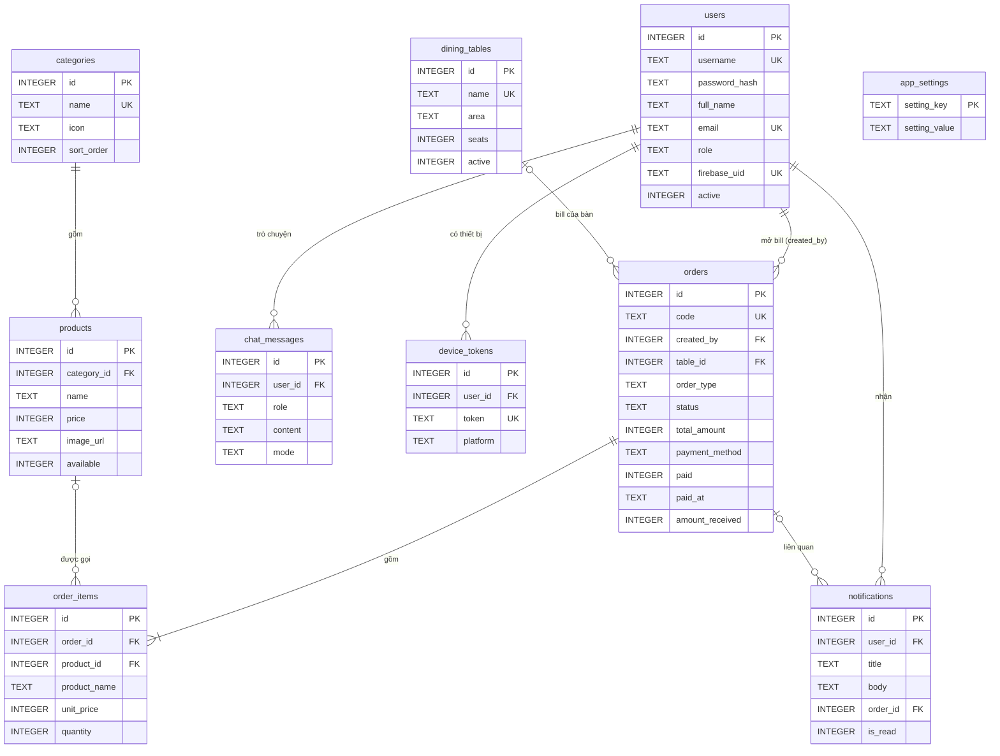

# Cơ sở dữ liệu

Hệ thống dùng **2 CSDL SQLite**:

| CSDL | Nằm ở | Vai trò |
|---|---|---|
| `aicf-ban-hang.db` | máy chủ (`backend/data/`) | Dữ liệu chính, dùng chung cho mọi người dùng. Tạo bởi `backend/src/main/resources/db/schema.sql` |
| `aicf_local` | trong điện thoại (app Android) | Dữ liệu cục bộ: phiên đăng nhập, phiếu gọi món đang chọn dở, thực đơn lưu tạm để dùng khi mạng chập chờn. Tạo bởi `frontend/www/js/data/local-db.js` |

## 1. CSDL máy chủ

### Quy ước
- Khóa chính `id INTEGER PRIMARY KEY AUTOINCREMENT`.
- Ngày giờ lưu `TEXT` dạng `YYYY-MM-DD HH:MM:SS` (giờ Việt Nam) → đọc được bằng mắt, so sánh theo chữ vẫn đúng thứ tự thời gian. Java đổi qua lại bằng `LocalDateTimeConverter`.
- Đúng/sai lưu `INTEGER` 0/1; tiền lưu `INTEGER` đơn vị đồng.
- Giá trị liệt kê (vai trò, trạng thái) lưu `TEXT` + ràng buộc `CHECK`.
- Bật `PRAGMA foreign_keys=ON` (trên URL kết nối) để SQLite kiểm tra khóa ngoại.
- `schema.sql` chỉ dùng `CREATE … IF NOT EXISTS` nên chạy lại mỗi lần khởi động không mất dữ liệu; `data.sql` chỉ thêm dữ liệu mẫu khi bảng còn trống.

### Sơ đồ quan hệ (ERD)



### Các bảng

| Bảng | Ý nghĩa | Điểm đáng chú ý |
|---|---|---|
| `users` | Tài khoản người trong quán | `password_hash` băm BCrypt; `role` ∈ OWNER (chủ quán) / MANAGER (quản lý) / STAFF (nhân viên bán hàng); `email` trùng tài khoản Google thì đăng nhập Google được, `firebase_uid` lưu liên kết; `active` = 0 khi nhân viên nghỉ (giữ lịch sử đơn) |
| `categories` | Danh mục món | `name` UNIQUE; không xóa được khi còn món (`ON DELETE RESTRICT` + kiểm tra ở service) |
| `products` | Món | `price ≥ 0`; `available` = 0 thì món hiện "Tạm hết", không gọi được; chỉ mục `idx_products_category` |
| `dining_tables` | Bàn | `area` để nhóm bàn theo khu vực trên sơ đồ bàn; đặt tên không dùng `tables` để tránh nhầm với khái niệm "bảng" |
| `orders` | Bill của 1 bàn / 1 đơn mang đi | `created_by` = nhân viên mở bill; `code` dạng `DH<ngày>-<id>`; `status` theo máy trạng thái NEW→PREPARING→READY→SERVED→COMPLETED (hoặc CANCELLED); mỗi bàn tối đa 1 bill đang mở; `total_amount` do máy chủ tính; `paid_at` + `payment_method` + `amount_received` khi thu tiền; chỉ mục theo `created_by`, `status`, `created_at`, `paid_at` (doanh thu theo ngày) |
| `order_items` | Dòng món | **chụp lại** `product_name`, `unit_price` lúc gọi món → đổi giá sau này không làm sai đơn cũ; `ON DELETE CASCADE` theo đơn |
| `chat_messages` | Lịch sử chat AI | `role` USER/ASSISTANT; `mode` LLM (AI thật) / OFFLINE (chế độ cơ bản) |
| `device_tokens` | Mã FCM của thiết bị | `token` UNIQUE – đăng nhập tài khoản khác trên cùng máy thì mã chuyển chủ; mã Firebase báo hết hiệu lực được tự xóa |
| `notifications` | Hộp thư trong app | đơn mới / gọi thêm (cho quầy pha chế), đồ đã xong (cho người mở bill), đơn hủy (cho chủ quán, quản lý); luôn lưu kể cả khi chưa bật Firebase |
| `app_settings` | Cấu hình khóa/giá trị | tên quán, giờ mở cửa, dịch vụ AI, khóa API… chủ quán sửa trên app |

Chú thích **từng cột** nằm ngay trong [`schema.sql`](../backend/src/main/resources/db/schema.sql).

### Truy vấn tiêu biểu (JPQL trong repository)

```sql
-- Doanh thu trong khoảng thời gian = bill đã thu tiền, không tính bill hủy (OrderRepository.revenueBetween)
SELECT COALESCE(SUM(o.totalAmount), 0) FROM CustomerOrder o
WHERE o.paid = true AND o.status <> CANCELLED AND o.paidAt >= :from AND o.paidAt < :to

-- Món bán chạy (OrderItemRepository.topProducts) – GROUP BY trên tên món đã chụp lại
SELECT new TopProduct(i.productName, SUM(i.quantity), SUM(i.unitPrice * i.quantity))
FROM OrderItem i JOIN i.order o
WHERE o.paid = true AND o.status <> CANCELLED AND o.paidAt >= :from AND o.paidAt < :to
GROUP BY i.productName ORDER BY SUM(i.quantity) DESC
```

## 2. CSDL trong điện thoại (`aicf_local`)

```sql
CREATE TABLE kv (key TEXT PRIMARY KEY, value TEXT NOT NULL);           -- session.token, session.user, server_url, push.token, draft.target
CREATE TABLE cart_items (product_id INTEGER PRIMARY KEY, name TEXT NOT NULL, price INTEGER NOT NULL,
                         image_url TEXT, quantity INTEGER NOT NULL CHECK (quantity > 0), note TEXT);
CREATE TABLE cached_products (id INTEGER PRIMARY KEY, json TEXT NOT NULL, cached_at TEXT NOT NULL);
```

- `cart_items` là **phiếu gọi món đang chọn dở** của 1 bàn (`kv.draft.target` = "table:3" / "order:12" / "takeaway"): app bị tắt giữa chừng, mở lại cùng bàn vẫn còn món. Khi gửi chỉ gửi `productId` + `quantity` + ghi chú, máy chủ tự lấy giá thật.
- Mạng chập chờn: màn Chọn món đọc `cached_products` và hiện dải báo "Đang mất mạng".
- PWA trên trình duyệt dùng localStorage với **cùng các hàm** (`kvGet`, `cartList`, `cacheProducts`…) – mẫu Adapter, phần còn lại của app không cần biết bên dưới là gì.
