# Luồng hoạt động các chức năng

App bán hàng **nội bộ** của quán cà phê: chủ quán mua về cho nhân viên bán hàng và quản lý dùng. Không có phần cho khách.

Các sơ đồ viết bằng **Mermaid**: GitHub và khung xem trước Markdown của VS Code tự vẽ thành hình.
Muốn chèn vào Word / PowerPoint: dán từng khối vào <https://mermaid.live> → *Actions* → tải PNG/SVG.

| # | Sơ đồ | Loại |
|---|---|---|
| 1 | [Kiến trúc tổng thể](#1-kiến-trúc-tổng-thể) | thành phần |
| 2 | [Điều hướng màn hình theo vai trò](#2-điều-hướng-màn-hình-theo-vai-trò) (2a vai trò, 2b router) | flowchart |
| 3 | [Xử lý 1 request REST (bảo mật JWT)](#3-xử-lý-1-request-rest-bảo-mật-jwt) | sequence |
| 4 | [Đăng nhập bằng mật khẩu](#4-đăng-nhập-bằng-mật-khẩu) | sequence |
| 5 | [Đăng nhập Google (Firebase)](#5-đăng-nhập-google-firebase-authentication) | sequence |
| 6 | [Một vòng bán hàng tại bàn](#6-một-vòng-bán-hàng-tại-bàn) | flowchart |
| 7 | [Mở bill (bên trong máy chủ)](#7-mở-bill-bên-trong-máy-chủ) | sequence |
| 8 | [Vòng đời trạng thái bill](#8-vòng-đời-trạng-thái-bill) | state |
| 9 | [Pha chế → phục vụ nhận thông báo](#9-pha-chế--phục-vụ-nhận-thông-báo) | sequence |
| 10 | [Thu tiền](#10-thu-tiền) | sequence |
| 11 | [Thông báo trong app + đẩy FCM](#11-thông-báo-trong-app--thông-báo-đẩy-fcm) | sequence |
| 12 | [Trợ lý AI](#12-trợ-lý-ai) | flowchart |
| 13 | [Quản lý thực đơn & bàn (CRUD tổng quát)](#13-quản-lý-thực-đơn--bàn-crud-tổng-quát) | sequence |
| 14 | [Quản lý tài khoản nhân viên](#14-quản-lý-tài-khoản-nhân-viên) | flowchart |
| 15 | [Tổng quan doanh thu](#15-tổng-quan-doanh-thu) | sequence |
| 16 | [Phiếu gọi món nháp + mạng chập chờn (SQLite trên máy)](#16-phiếu-gọi-món-nháp--mạng-chập-chờn-sqlite-trên-điện-thoại) | flowchart |

---

## 1. Kiến trúc tổng thể

Một máy chủ Spring Boot (cổng 8090) vừa phục vụ giao diện PWA vừa cung cấp REST API dùng chung cho mọi thiết bị trong quán.
App Android chứa sẵn bản sao giao diện, chỉ gọi REST API qua Wi-Fi của quán.

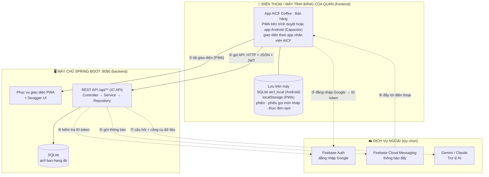

---

## 2. Điều hướng màn hình theo vai trò

**2a. Mỗi vai trò thấy gì.** Bố cục giống app nhân viên AICF: 4 màn đầu nằm trên thanh dưới, phần còn lại vào mục "Thêm".

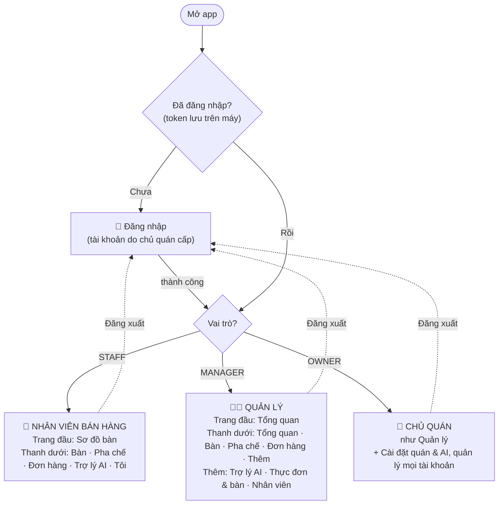

**2b. Router kiểm tra mỗi lần đổi màn** (`js/core/router.js`):

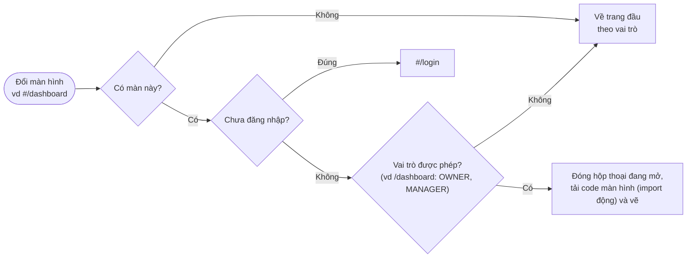

---

## 3. Xử lý 1 request REST (bảo mật JWT)

Mọi API đi qua cùng một đường: bộ lọc JWT → luật quyền → Controller → Service → Repository → SQLite. Lỗi ở bất kỳ bước nào đều được đổi thành cùng một dạng JSON.

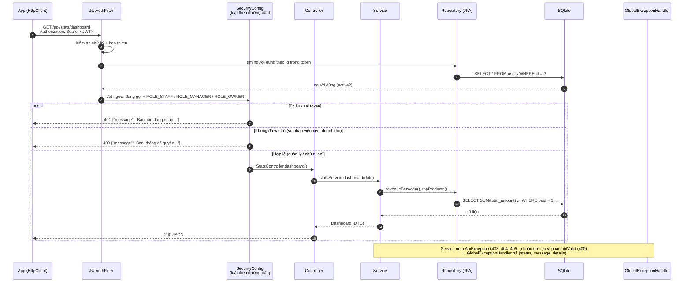

---

## 4. Đăng nhập bằng mật khẩu

Không có đăng ký tự do: chủ quán / quản lý tạo tài khoản ở màn Nhân viên (sơ đồ 14).

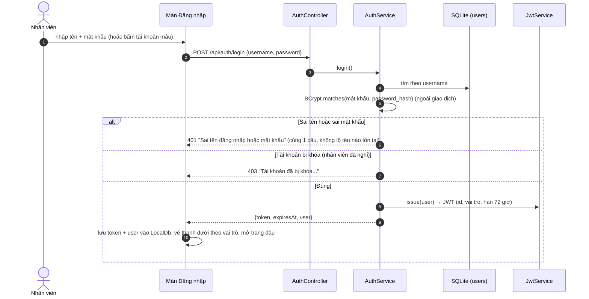

---

## 5. Đăng nhập Google (Firebase Authentication)

Chỉ người đã được chủ quán cấp tài khoản (có nhập email Google) mới vào được.

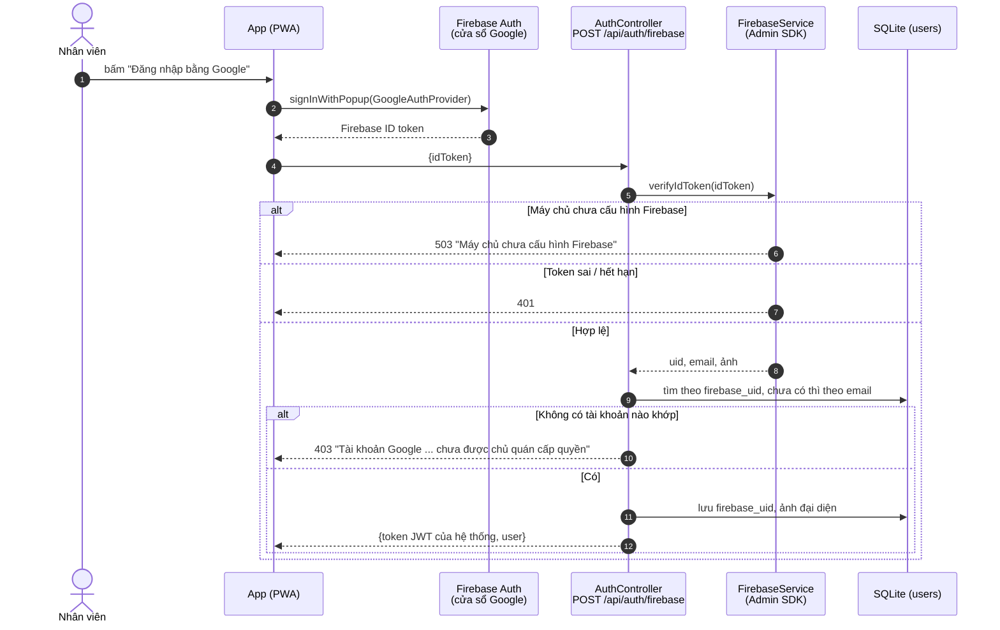

---

## 6. Một vòng bán hàng tại bàn

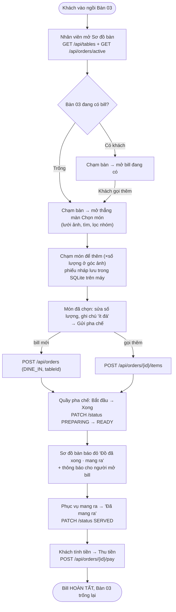

---

## 7. Mở bill (bên trong máy chủ)

```mermaid
sequenceDiagram
    autonumber
    participant App as App (bill.js)
    participant C as OrderController
    participant S as OrderService (@Transactional)
    participant DB as SQLite
    participant N as NotificationService

    App->>C: POST /api/orders {orderType: DINE_IN, tableId: 3, items:[{productId, quantity, note}]}
    C->>C: @Valid: có món? số lượng 1–99?
    C->>S: create(me, request)
    S->>DB: bàn 3 tồn tại, đang dùng?
    S->>DB: bàn 3 có bill đang mở? (existsByTableIdAndStatusIn)
    alt Đã có bill
        S-->>App: 409 "Bàn 03 đang có bill, hãy thêm món vào bill đó"
    else Trống
        loop từng món
            S->>DB: lấy món; tạm hết → 409 (cả giao dịch hủy, không lưu gì)
            S->>S: chụp lại tên + giá lúc gọi món
        end
        S->>S: tổng tiền = Σ đơn giá × số lượng (không tin giá app gửi)
        S->>DB: INSERT orders (created_by = nhân viên) + order_items
        S->>DB: mã đơn DH<ngày>-<id>
        S->>N: notifyTeam("Đơn mới · Bàn 03", ...) trừ người vừa tạo
        S-->>App: 201 OrderResponse (status NEW "Chờ pha")
    end
```

---

## 8. Vòng đời trạng thái bill

Luật chuyển nằm ở **một chỗ** (`OrderStatus.canMoveTo`), API và Trợ lý AI đều theo.

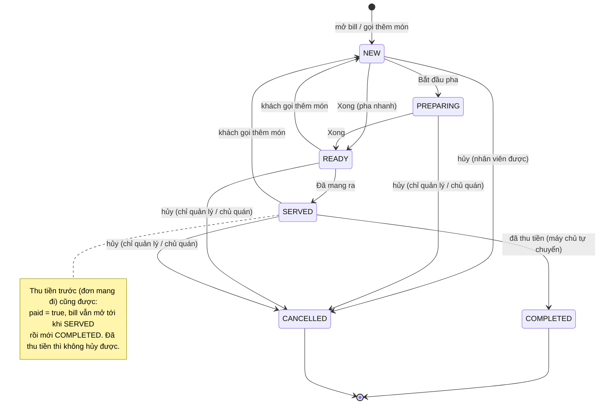

---

## 9. Pha chế → phục vụ nhận thông báo

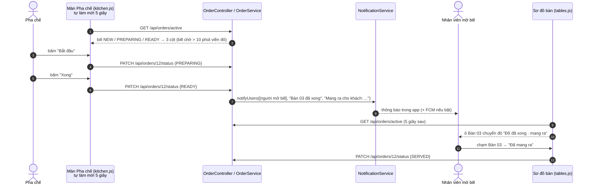

---

## 10. Thu tiền

Mẫu **Strategy** ở app (`payment.js`): mỗi cách trả là 1 đối tượng tự vẽ phần nhập và tạo dữ liệu gửi đi.

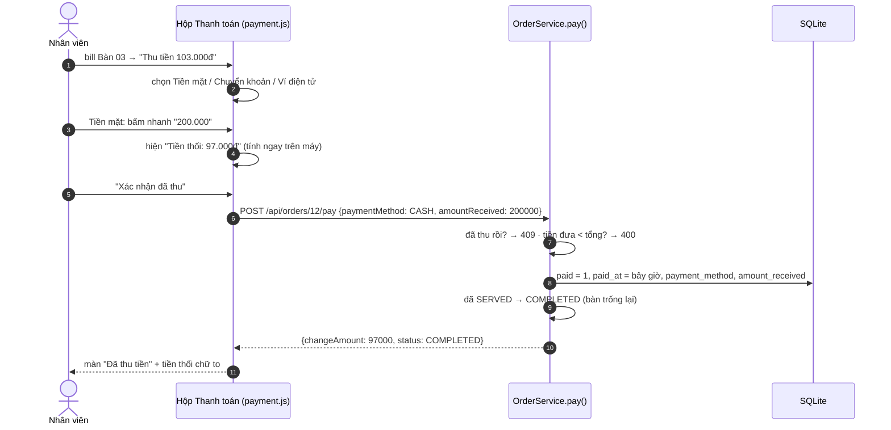

---

## 11. Thông báo trong app + thông báo đẩy (FCM)

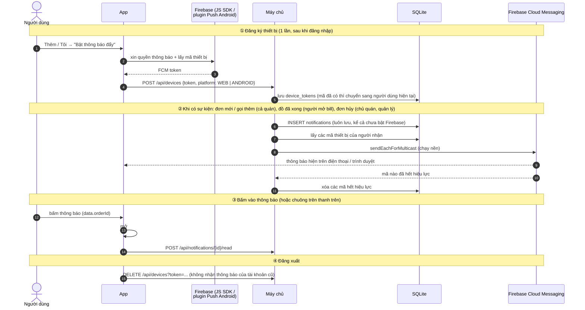

---

## 12. Trợ lý AI

Tận dụng thiết kế Trợ lý AI của dự án AICF: chọn nhà cung cấp (Strategy), AI chỉ lấy số liệu qua **công cụ** (function calling), lỗi thì tự chuyển sang chế độ cơ bản.

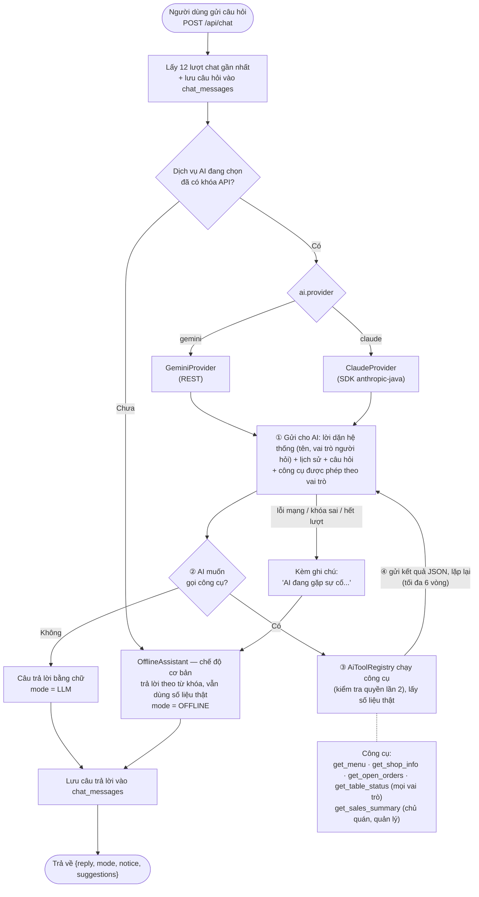

---

## 13. Quản lý thực đơn & bàn (CRUD tổng quát)

Món, Danh mục, Bàn dùng **chung một khung** ở cả hai phía: `crudPage()` + `createCrudRepository()` trên app, `CrudController` + `CrudService` trên máy chủ.

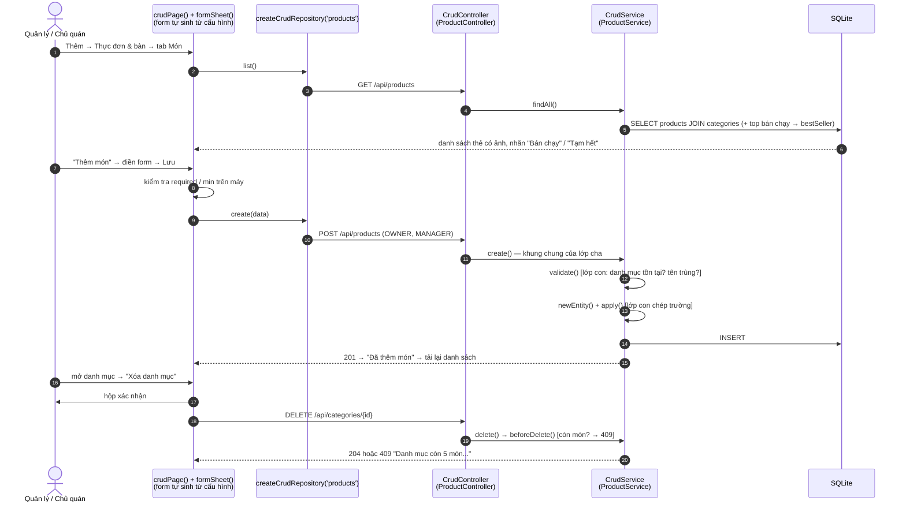

---

## 14. Quản lý tài khoản nhân viên

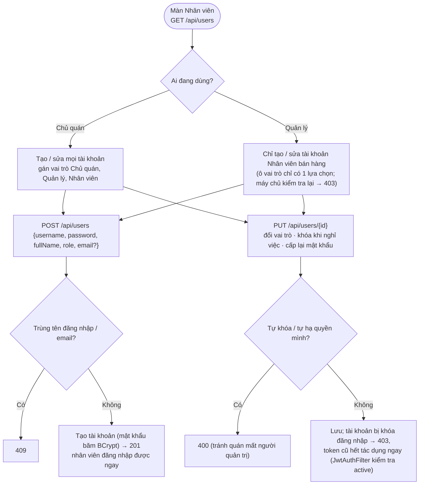

---

## 15. Tổng quan doanh thu

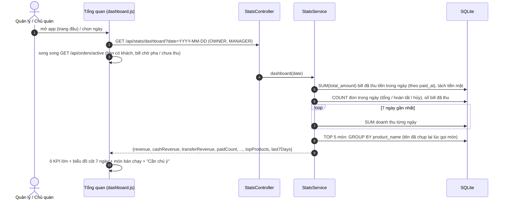

---

## 16. Phiếu gọi món nháp + mạng chập chờn (SQLite trên điện thoại)

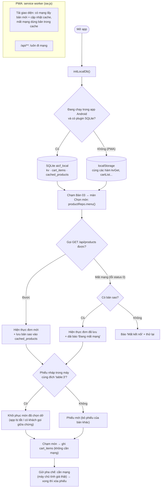
